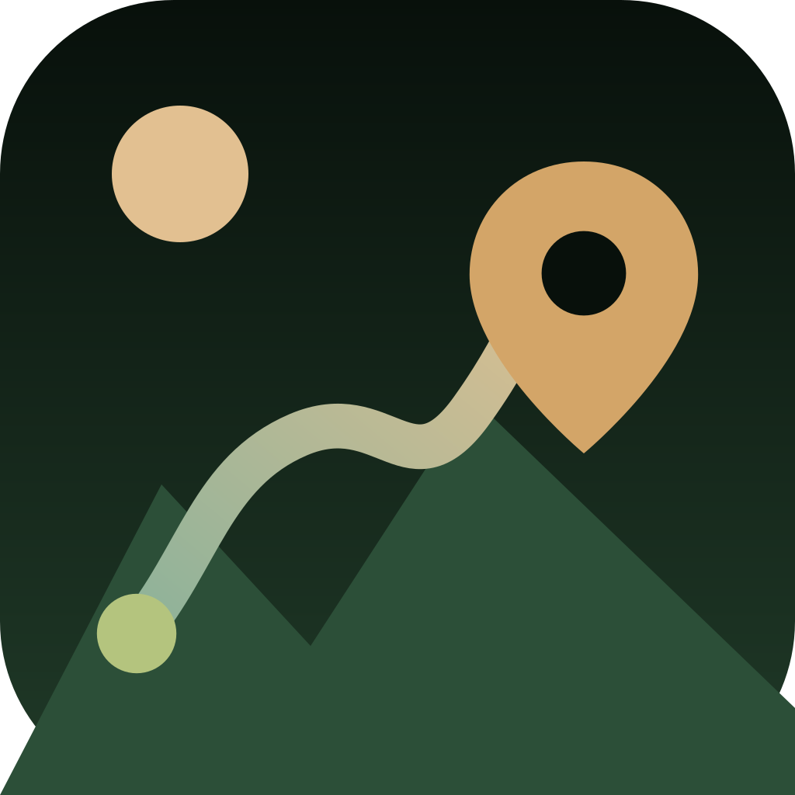
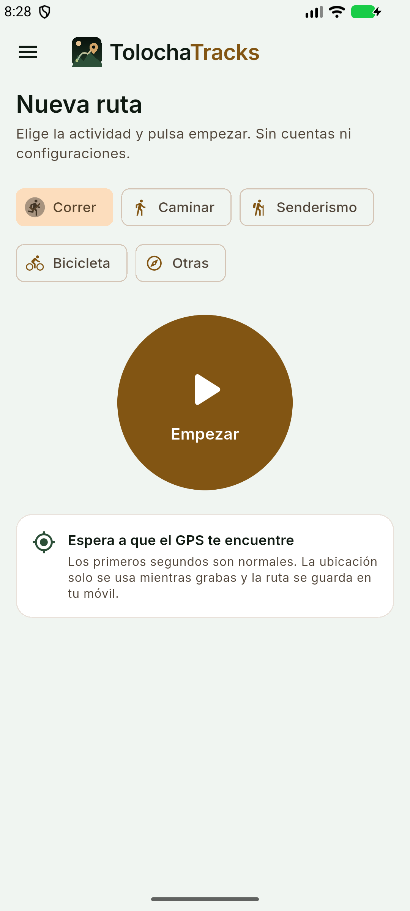
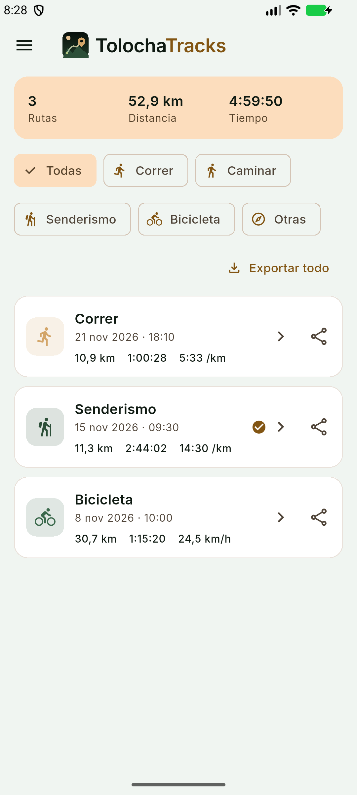
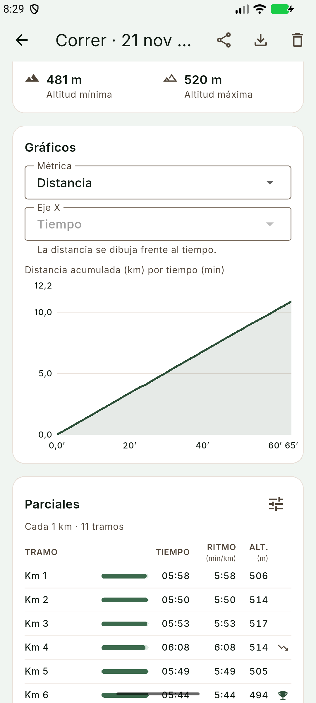
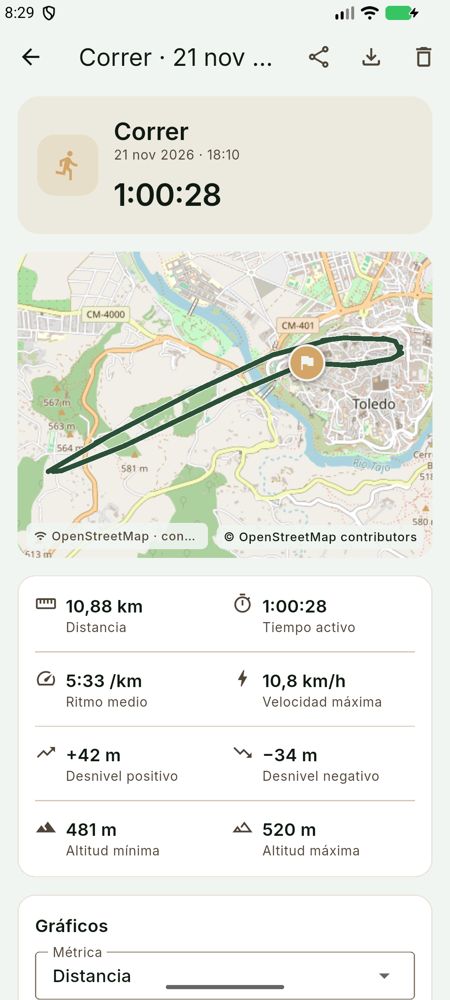
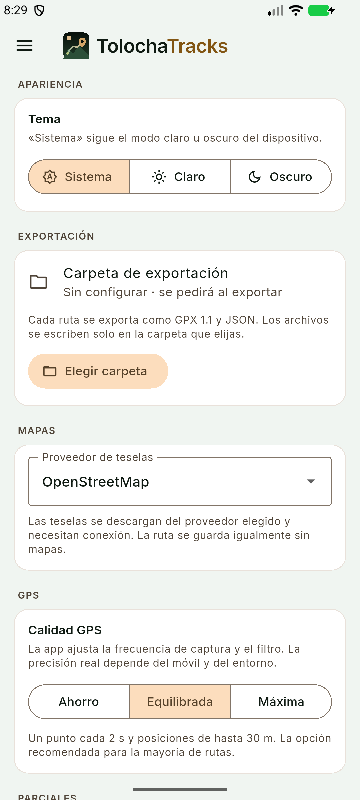

# TolochaTracks

  

  <strong>Graba tus rutas y olvídate del móvil.</strong> 
  Correr, caminar, senderismo, bicicleta y mucho más, con tus datos en tu bolsillo.

  
  
  

TolochaTracks es una app Android para registrar rutas GPS de forma rápida y sencilla.
Abres, pulsas **Empezar** y te pones en marcha. La app graba aunque apagues la pantalla,
guarda la ruta en el teléfono y te deja consultarla, exportarla o compartirla cuando
quieras.

Está inspirada en la antigua MyTracks de Google: menos configuración, más camino.

## Capturas

  
  
  

  
  

<em>Capturas reales de la app en un Android de ejemplo.</em>

## Qué puedes hacer

### Grabar sin complicaciones

- Elige la actividad y pulsa el botón redondo para empezar.
- Pausa, reanuda y termina desde la propia app o desde la notificación, sin abrirla.
- La grabación sigue con la pantalla apagada gracias al servicio en primer plano.
- Tres perfiles de GPS —Ahorro, Equilibrada y Máxima— para elegir entre detalle y
  batería.
- Estadísticas en vivo: distancia, tiempo, ritmo o velocidad, altitud y desnivel.
- Si la app se interrumpe, guarda un borrador y te ofrece recuperar la ruta al volver.

### Consultar tus rutas

- Historial ordenado por fecha, con filtro por actividad y totales de distancia y tiempo.
- Detalle con distancia, duración, ritmo o velocidad, desnivel, altitud y velocidad
  máxima.
- Gráficos de distancia, velocidad, altitud y metros por minuto.
- Parciales por kilómetro o por tiempo, configurables.
- Cada ruta se puede exportar, compartir o borrar, también con sus archivos exportados.

### Mapas libres, si los quieres

- OpenStreetMap, OpenTopoMap, CyclOSM o **sin mapas**.
- La ruta se dibuja sobre el mapa y la atribución está siempre visible.
- Los mapas son opcionales: sin conexión, la grabación, el historial, las estadísticas y
  la exportación siguen funcionando.

### Llevarte tus datos

- Exporta una ruta o todo el historial visible en **GPX 1.1** y **JSON**.
- Elige la carpeta de destino con el selector de Android y cámbiala cuando quieras.
- Comparte una ruta con el share sheet del teléfono.

## Instalación

Descarga la última versión:

  <a href="https://github.com/izquierdojl/tolochatracks/releases/latest/download/tolochatracks.apk"><strong>Descargar tolochatracks.apk</strong></a>

1. Abre el APK desde el navegador o el gestor de archivos.
2. Si Android lo pide, permite la instalación desde esa aplicación.
3. Acepta el aviso de instalación y abre TolochaTracks.

Las actualizaciones se instalan encima sin desinstalar mientras se mantenga la misma
firma. TolochaTracks no está en Play Store; las versiones se publican en
[GitHub Releases](https://github.com/izquierdojl/tolochatracks/releases).

**Requisitos:** Android 7.0 o superior (minSdk 24), GPS y, solo si quieres mapas,
conexión a internet.

## Privacidad

Tus rutas son tuyas:

- Se guardan únicamente en el teléfono. No hay cuentas, telemetría ni servidores propios.
- La única conexión a internet son las teselas del mapa que elijas. Puedes desactivarlas.
- Exportar o compartir una ruta siempre es una acción tuya.
- La app no descarga mapas en bloque ni envía tu posición a ningún servidor.

Puedes leer los detalles en
[Privacidad, permisos y mapas](docs/privacidad-y-mapas.md).

## Preguntas frecuentes

**¿Necesito internet para usarla?**
Solo para ver los mapas. La grabación, el historial, las estadísticas y la exportación
funcionan sin conexión.

**¿Funciona con la pantalla apagada?**
Sí. La grabación usa un servicio en primer plano y una notificación persistente. Para
rutas largas, permite que Android no optimice la batería de TolochaTracks desde Ajustes.

**¿Por qué no está en Play Store?**
Por ahora se distribuye como APK firmado desde GitHub Releases. Play Store está aplazada.

**¿Cómo actualizo?**
Descarga el APK nuevo e instálalo encima. No pierdes las rutas ni los ajustes.

**¿Dónde están mis rutas?**
En el almacenamiento privado de la app. Si quieres una copia, expórtalas a la carpeta que
elijas en GPX o JSON.

**¿Puedo usar la app sin mapas?**
Sí. En Ajustes elige «Sin mapas» y la app no hará ninguna petición de teselas.

## Licencia

El código de TolochaTracks se distribuye bajo **licencia MIT**. Puedes usarlo, modificarlo
y compartirlo conservando el aviso de copyright. Consulta el archivo
[`LICENSE`](LICENSE).

Los datos de los mapas mantienen su licencia:
[OpenStreetMap](https://www.openstreetmap.org/copyright) © OpenStreetMap contributors
(ODbL), [OpenTopoMap](https://opentopomap.org/about) © OpenTopoMap · © OpenStreetMap
contributors y [CyclOSM](https://www.cyclosm.org) © CyclOSM · © OpenStreetMap
contributors. La tipografía Inter se distribuye bajo SIL Open Font License 1.1.

TolochaTracks no está afiliado a Google ni a MyTracks.

## Documentación técnica

La portada está pensada para usar la app. Si vas a desarrollar, publicar o auditar el
proyecto, empieza por el [índice de documentación](docs/README.md):

- [Desarrollo](docs/desarrollo.md): entorno, comandos, estructura y flujo OpenSpec.
- [Arquitectura](docs/arquitectura.md): capas, estado, persistencia y grabación.
- [Exportación](docs/exportacion.md): GPX, JSON, SAF y errores.
- [Releases](docs/releases.md): versionado semver, CI/CD y firma del APK.
- [Privacidad y mapas](docs/privacidad-y-mapas.md): permisos, batería y atribución.
- [AGENTS.md](AGENTS.md): constitución y reglas de gobernanza del proyecto.

## Estado

En desarrollo (versión `0.x`). Solo Android, distribuida como APK. Las funciones nuevas
entran como changes de OpenSpec y cada fusión en `dev` publica una versión cuando la CI
está en verde.
